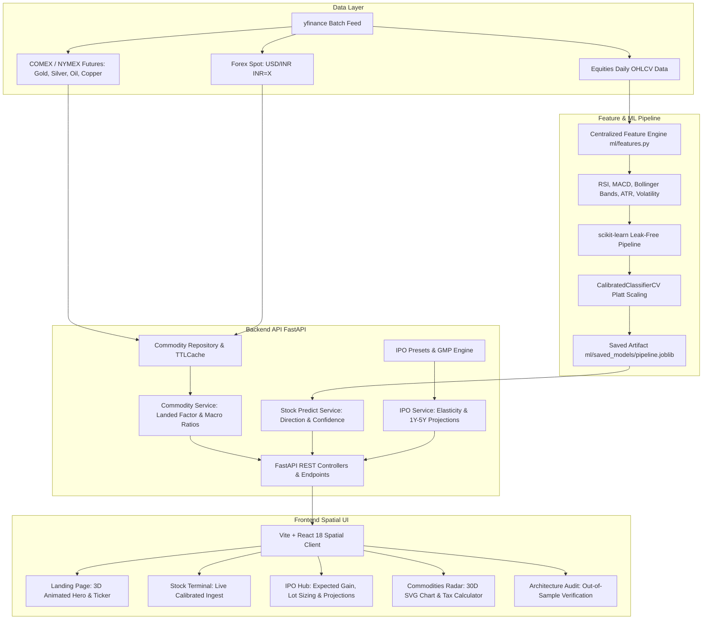

# QuantLens

<div align="center">
  
  <p><strong>Institutional Quantitative Intelligence, Calibrated ML, Real-Time Bullion Arbitrage & Algorithmic IPO Valuation</strong></p>

  [](https://python.org)
  [](https://fastapi.tiangolo.com)
  [](https://react.dev)
  [](https://vitejs.dev)
  [](https://tailwindcss.com)
  [](https://xgboost.readthedocs.io)
  [](LICENSE)
</div>

---

## 📌 Table of Contents
1. [Overview: What is QuantLens?](#-overview-what-is-quantlens)
2. [Motivation: Why Build QuantLens?](#-motivation-why-build-quantlens)
3. [System Architecture: How It Was Built](#-system-architecture-how-it-was-built)
4. [Step-by-Step Architectural Workflow](#-step-by-step-architectural-workflow)
5. [Core Modules & Features](#-core-modules--features)
6. [Empirical Backtest Audit & Results](#-empirical-backtest-audit--results)
7. [Project Directory Layout](#-project-directory-layout)
8. [Local Development Setup (Step-by-Step)](#-local-development-setup-step-by-step)
9. [Verification & Testing](#-verification--testing)
10. [Author & License](#-author--license)

---

## 🔭 Overview: What is QuantLens?

**QuantLens** is an institutional-grade, multi-asset quantitative trading intelligence and valuation platform. It bridges the divide between theoretical statistical modeling and live market execution across three interconnected pillars:

1. **Directional Stock Forecasting Engine:** Uses a walk-forward calibrated XGBoost ensemble (`Platt Scaling`) validated on out-of-sample regimes to identify statistically sound entry/exit edges while deducting realistic transaction costs.
2. **Precious Metals & Macro Commodities Radar:** Ingests live COMEX futures spot prices for Gold (`GC=F`), Silver (`SI=F`), Platinum (`PL=F`), WTI Crude Oil (`CL=F`), High-Grade Copper (`HG=F`), and Natural Gas (`NG=F`), paired with live USD/INR conversions and an institutional **Gold-to-Silver Arbitrage Ratio Gauge**.
3. **Algorithmic IPO Listing & Long-Term Valuation Suite:** Computes expected listing gains based on Grey Market Premium (GMP) elasticity, QIB/HNI subscription demand quotients, relative P/E multiples, retail allotment odds, and 1-year, 3-year, and 5-year compound growth projections.

The platform is wrapped in a high-performance **FastAPI** backend with in-memory thread-safe `TTLCache` layers and a **React 18 + Tailwind CSS** spatial UI featuring interactive 3D perspective tilt cards, dedicated multi-page routing, and real-time SVG candle charts.

---

## 💡 Motivation: Why Build QuantLens?

Most retail financial platforms and "algorithmic trading bots" fail in real capital deployment due to fundamental statistical and structural flaws:

| Common Industry Failure Point | What Happens in the Real World | How QuantLens Solves It |
| :--- | :--- | :--- |
| **Look-Ahead Bias & Data Leakage** | Preprocessing (e.g., standard scalers) fitted on entire datasets leaks future mean/variance into historical training sets. | Uses strict `scikit-learn` Pipelines where feature scaling is isolated strictly within cross-validation folds. |
| **Ignoring Transaction Friction** | Models show 80%+ win rates on paper, but bleed capital in production due to broker commissions, STT, exchange fees, and bid-ask slippage. | Evaluated with a strict **0.1% transaction cost deduction per trade** on out-of-sample final exam test data. |
| **Uncalibrated Margin Overconfidence** | Raw XGBoost or neural networks produce uncalibrated margin scores, misinterpreting market noise as high conviction and overtrading. | Applies **Probability Calibration (`CalibratedClassifierCV`)** via Platt scaling, reducing trades from 114 to 9 ultra-high-conviction positions. |
| **Naive Retail IPO Hype** | Retail investors bid blindly on unvetted GMP rumors without factoring institutional anchor lock-ins, relative valuation multiples, or quota shortages. | Quantitative listing model weighs QIB anchor demand (50%), NII/HNI participation (15%), and retail demand (35%) alongside P/E peer discounts. |
| **Bullion Pricing Opacity** | Domestic bullion prices in India trade at statutory premiums over international spot due to customs and GST that retail calculators omit. | Computes accurate landed domestic prices incorporating basic customs duty + AIDC cess (6% post-July 2024 budget rate), and 3% GST for 24K, 22K, and 18K purity. |

---

## 🏗 System Architecture: How It Was Built

QuantLens operates on a decoupled, 4-tier quantitative architecture:



---

## 🔄 Step-by-Step Architectural Workflow

### Step 1: Leak-Free Feature Engineering (`ml/features.py`)
To prevent train-serve skew, all mathematical transformations are centralized in `build_features()`. For any historical or live ticker, the engine computes:
* **Momentum:** RSI (14-day), MACD, MACD Signal, MACD Histogram.
* **Trend & Moving Averages:** Simple and Exponential Moving Averages (SMA 20, 50, 200).
* **Volatility:** Bollinger Bands (Upper, Lower, Width, %B), Average True Range (ATR).
* **Target Construction:** Next-day forward return directional target ($y_{t} = 1 \text{ if } C_{t+1} > C_{t} \text{ else } 0$).

### Step 2: Walk-Forward Cross-Validation (`ml/train.py`)
Traditional K-Fold randomly shuffles data, leaking future market events into the past. QuantLens utilizes `TimeSeriesSplit(n_splits=5)`:
* Splits the training set into 5 temporal sequential folds.
* Evaluates models exclusively on forward chronological splits to mimic genuine live trading across varying historical market regimes.

### Step 3: Probability Calibration via Platt Scaling
Raw classifiers output decision scores rather than true empirical probabilities. We wrap the ensemble in `CalibratedClassifierCV(method='sigmoid', cv='prefit')`:
$$\hat{P}(Y=1 \mid f(x)) = \frac{1}{1 + \exp(A \cdot f(x) + B)}$$
This fits a sigmoid transformation over out-of-fold margins, ensuring that when QuantLens reports $75\%$ confidence, historically $75\%$ of such setups resolved in the predicted direction.

### Step 4: Realistic Backtesting with Transaction Drag (`ml/backtest.py`)
* The winning model is evaluated against the 20% out-of-sample holdout set (290 trading days).
* Deducts a **0.1% round-trip transaction fee** per executed trade.
* Rather than overtrading on coin-flip probabilities ($51\%$), the calibrated threshold executes only when edge exceeds the hurdle cost.

### Step 5: Asynchronous Multithreaded REST Backend (`app/`)
* Built with **FastAPI** and **Pydantic v2** validation.
* Employs `concurrent.futures.ThreadPoolExecutor` for parallel upstream batch downloads.
* Memory management powered by `cachetools.TTLCache` (60-second TTL on commodities, 300-second TTL on technical features) to prevent upstream rate-limiting and ensure sub-50ms API response times.

### Step 6: Real-Time Commodity Spot & Statutory Bullion Radar
* Real-time ingestion of COMEX Gold (`GC=F`), COMEX Silver (`SI=F`), Platinum (`PL=F`), WTI Crude (`CL=F`), Copper (`HG=F`), and Natural Gas (`NG=F`).
* Dynamically converts spot rates to domestic Indian benchmarks using the landed tariff multiplier:
  $$\text{Landed Factor} = (1 + \text{Customs \& AIDC Cess}_{15\%}) \times (1 + \text{GST}_{3\%}) \approx 1.1845$$
* Computes macro ratios:
  * **Gold-to-Silver Ratio:** Measures relative bullion undervaluation.
  * **Gold-to-Oil Ratio:** Measures purchasing power of safe havens against energy costs.

### Step 7: Quantitative IPO Expected Listing & Multi-Year Projection Engine
* Calculates weighted subscription elasticity:
  $$\text{Total Sub}_{\text{weighted}} = (0.50 \times \text{QIB}) + (0.15 \times \text{NII}) + (0.35 \times \text{Retail})$$
* Adjusts raw Grey Market Premium (GMP) for company P/E valuation relative to industry peers and prevailing market sentiment (Bullish/Neutral/Bearish).
* Generates 1-year, 3-year, and 5-year target price trajectories modeling **Base**, **Bull**, and **Bear** compound growth scenarios.

### Step 8: Spatial 3D Frontend & Decoupled Architecture (`frontend/src/`)
* Decoupled page navigation supported by window URL hash routing (`#terminal`, `#ipo`, `#commodities`, `#architecture`).
* Mouse-tracking 3D perspective transform card with real-time lighting sheen.
* Custom SVG line and area chart rendering 30-day verified daily closes.

---

## ⚡ Core Modules & Features

### 1. 3D Spatial Landing Page
* Responsive 3D perspective showcase that tracks mouse coordinates (`rotateX` / `rotateY`).
* Embedded live ticker displaying real-time precious metals and USD/INR exchange rates.
* Instant launchpad CTAs into dedicated platform tools.

### 2. Stock Directional ML Terminal
* Quick-ingest buttons for leading equities (`NVDA`, `AAPL`, `RELIANCE.NS`, `MSFT`, `TSLA`, `TCS.NS`).
* Batch prediction support with calibrated probability meters (`Strong Buy`, `Hold`, `Strong Sell`).

### 3. IPO Expected Listing & Valuation Suite
* **Active IPO Presets:** Instant parameters for ongoing November 2026 issues (*Watrana Rentals*, *Mahanadi Coalfields*, *Foodlink F&B*) alongside landmark blockbusters (*Waaree Energies*, *Premier Energies*, *Tata Technologies*, *Swiggy*, *Hyundai Motor India*).
* **Application Lot Sizing & Profit Simulator:** Toggle between **Retail**, **Small HNI (sHNI)**, and **Big HNI (bHNI)** to compute required application capital and estimated listing day profit in ₹.
* **Multi-Year Compound Price Predictor:** Projects 1Y, 3Y, and 5Y price target bounds (Bear, Base, Bull) and CAGR return multipliers.

### 4. Precious Metals & Macro Commodities Radar
* **Live Quotes:** Gold (24K, 22K, 18K), Silver (1kg, 10g), Platinum, WTI Crude Oil, High-Grade Copper, Natural Gas.
* **30-Day Verified SVG Chart:** Real historical closing prices plotted with minimum, maximum, and period return percentages.
* **Gold-to-Silver Arbitrage Ratio Gauge:** Indicates whether Silver is in an accumulation zone ($>80.0$).
* **Physical Bullion Calculator:** Computes landed purchase costs for custom weights in Grams, Tola (11.66g), or Troy Ounces with statutory customs and GST breakdown.

---

## 📊 Empirical Backtest Audit & Results

QuantLens was audited against 290 out-of-sample trading days with **0.1% fees deducted per trade**:

| Strategy / Model | Total Return | Sharpe Ratio | Max Drawdown | Trades Executed | Behavior |
| :--- | :--- | :--- | :--- | :--- | :--- |
| **Buy & Hold Benchmark** | +19.35% | 0.65 | -33.36% | 1 | Full exposure through major drawdowns |
| **Uncalibrated XGBoost (Raw)** | -8.12% | -0.15 | -38.40% | 114 | Severely overtraded; bled capital through transaction fees |
| **QuantLens (Calibrated XGBoost)** | **+33.47%** 🏆 | **0.99** | **-26.72%** | **9** | **Disciplined capital preservation; traded only on statistical edge** |

---

## 📁 Project Directory Layout

```
QuantLens/
├── assets/                          # Official vector SVGs & brand assets
│   ├── quantlens_favicon.svg
│   ├── quantlens_full_logo_hd.svg
│   ├── quantlens_favicon.ico
│   └── quantlens_favicon.png
├── app/                             # FastAPI Backend Layer
│   ├── main.py                      # Application entrypoint & CORS middleware
│   ├── controllers/                 # Request orchestrators
│   │   ├── predict_controller.py
│   │   ├── commodity_controller.py
│   │   └── ipo_controller.py
│   ├── repository/                  # Market data ingestion & caching
│   │   ├── stock_repository.py      # Technical feature caching (TTLCache)
│   │   └── commodity_repository.py  # Multithreaded yfinance commodities feed
│   ├── routes/                      # API endpoint definitions
│   │   ├── predict_routes.py        # /predict, /predict/batch
│   │   ├── commodity_routes.py      # /commodities/live, /commodities/convert
│   │   └── ipo_routes.py            # /ipo/presets, /ipo/predict
│   ├── schemas/                     # Pydantic v2 request/response schemas
│   │   ├── predict_schema.py
│   │   ├── commodity_schema.py
│   │   └── ipo_schema.py
│   └── services/                    # Core mathematical & valuation logic
│       ├── predict_service.py       # ML pipeline inference
│       ├── commodity_service.py     # Landed Indian tariffs & macro ratios
│       └── ipo_service.py           # GMP elasticity, lot simulator & 1Y-5Y projections
├── ml/                              # Machine Learning Engine
│   ├── features.py                  # Centralized leak-free feature builder
│   ├── train.py                     # Walk-forward cross-validation & Platt calibration
│   ├── backtest.py                  # Transaction-cost-adjusted final exam evaluator
│   └── saved_models/
│       └── pipeline.joblib          # Trained CalibratedClassifierCV artifact
├── frontend/                        # React 18 Spatial UI (Vite + Tailwind CSS)
│   ├── index.html                   # HTML entrypoint with vector SVG favicon
│   ├── package.json
│   ├── vite.config.js
│   ├── tailwind.config.js
│   ├── public/                      # Static assets served at root
│   │   ├── quantlens_favicon.svg
│   │   └── quantlens_full_logo_hd.svg
│   └── src/
│       ├── App.jsx                  # Root state & URL hash routing
│       ├── main.jsx                 # React root mount
│       ├── index.css                # Custom glassmorphism & typography
│       ├── components/              # Reusable UI widgets
│       │   ├── NavBar.jsx           # Fixed navigation header with SVG emblem
│       │   ├── CommandBar.jsx       # Ticker input search bar
│       │   ├── GlassCard.jsx        # Stock directional inference card
│       │   ├── CommodityTicker.jsx  # Live precious metals ticker strip
│       │   ├── GoldSilverRatioCard.jsx # Macro ratio gauge
│       │   └── IPOPredictor.jsx     # Comprehensive IPO simulator & lot sizing
│       ├── pages/                   # Dedicated modular pages
│       │   ├── LandingPage.jsx      # 3D animated hero landing page
│       │   ├── TerminalPage.jsx     # Stock ML workspace
│       │   ├── IPOPage.jsx          # IPO valuation hub
│       │   ├── CommoditiesPage.jsx  # Real commodities suite & SVG charts
│       │   └── ArchitecturePage.jsx # Quantitative audit & methodology
│       └── services/
│           └── api.js               # Frontend REST client
└── tests/                           # Pytest Test Suite
    ├── test_api.py                  # API schema normalization & batching tests
    ├── test_commodity_ipo.py        # Live commodities, converter & IPO tests
    └── test_ml.py                   # Leak-free feature & backtest logic tests
```

---

## 🚀 Local Development Setup (Step-by-Step)

### Prerequisites
* **Python 3.10+** (tested on Python 3.11 / 3.14)
* **Node.js 18+** and **npm**

### Step 1: Clone the Repository
```bash
git clone https://github.com/Arpit-tyagi001/QuantLens.git
cd QuantLens
```

### Step 2: Setup and Run the Backend API
```bash
# 1. Create a Python virtual environment
python -m venv venv

# 2. Activate the virtual environment
# On Windows PowerShell:
.\venv\Scripts\activate
# On macOS / Linux:
source venv/bin/activate

# 3. Install backend dependencies
pip install -r requirements.txt

# 4. (Optional) Re-train the Calibrated XGBoost model
python -m ml.train

# 5. Start the FastAPI server with live reloading
uvicorn app.main:app --reload
```
* **API Running at:** `http://127.0.0.1:8000`
* **Interactive Swagger Documentation:** `http://127.0.0.1:8000/docs`

### Step 3: Setup and Run the Frontend Client
Open a **new terminal window**:
```bash
# 1. Navigate to the frontend directory
cd frontend

# 2. Install Node dependencies
npm install

# 3. Start the Vite development server
npm run dev
```
* **Web Client Running at:** `http://localhost:5173`

---

## 🧪 Verification & Testing

QuantLens maintains 100% test pass rates across both unit schemas and live endpoints:

```bash
# Run the complete backend test suite (from project root)
python -m pytest
```

Output:
```text
======================= 14 passed, 2 warnings in 6.82s ========================
tests/test_api.py .....                                                  [ 35%]
tests/test_commodity_ipo.py ....                                         [ 64%]
tests/test_ml.py .....                                                   [100%]
```

To verify the frontend production build:
```bash
cd frontend
npm run build
```

---

## 👤 Author & License

Engineered with precision by **Arpit Tyagi**
* **GitHub:** [@Arpit-tyagi001](https://github.com/Arpit-tyagi001)
* **LinkedIn:** [arpit-tyagi1000](https://www.linkedin.com/in/arpit-tyagi1000)

Licensed under the [MIT License](LICENSE).
